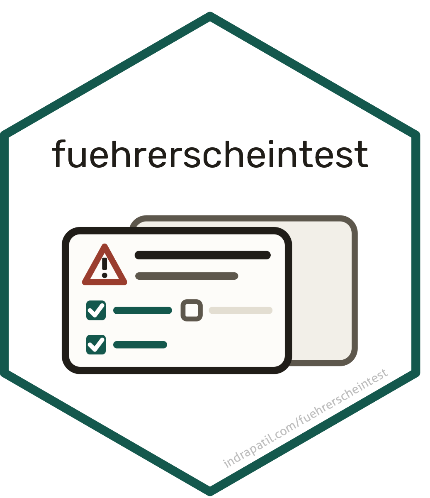
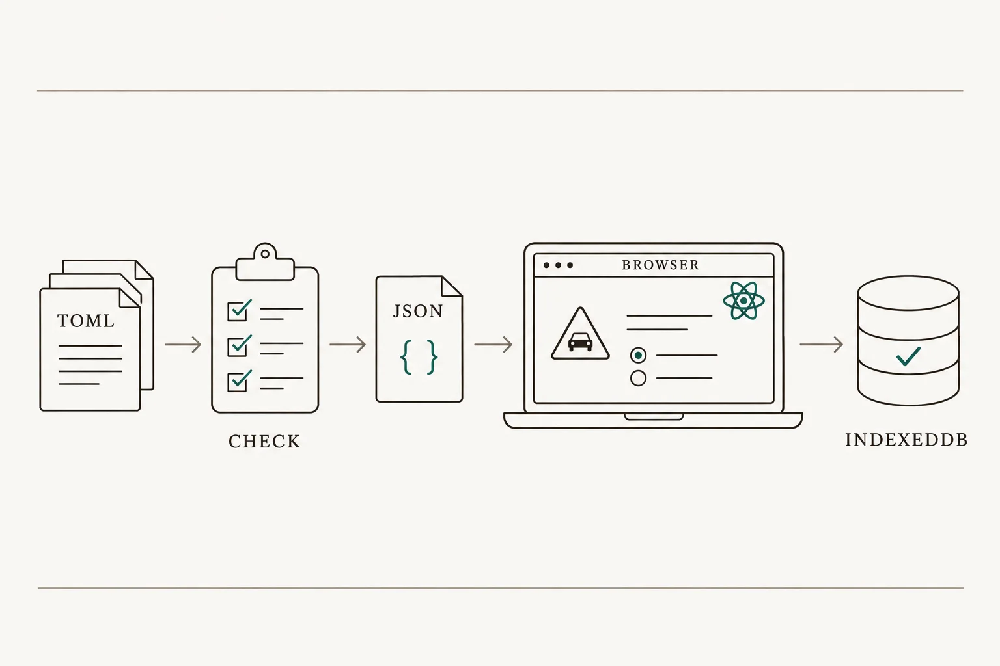

# Führerscheintest — driving theory trainer 

A free study app for the German class B driving theory test (_theoretische
Fahrerlaubnisprüfung_). Every question is shown in German and English side by
side, so the exam language and your own build a direct correspondence. Your
results stay in your browser, so you can watch your error points fall towards
exam day.

**Use it online:** <https://www.indrapatil.com/fuehrerscheintest/>

> [!IMPORTANT]
> The questions are original practice questions written from German traffic
> law, each citing the paragraph it follows from. They are **not** the
> official TÜV | DEKRA question catalogue, whose wording and media are
> licensed. Use them alongside your driving school's materials.

## What you can do

- **Take a mock exam** — the real format: 30 questions (20 Grundstoff, 10
  Klasse B), 45 minutes, multiple answers per question, 2 to 5 error points
  each. Pass with at most 10 error points; two missed 5-point questions fail.
- **Practise with explanations** — immediate feedback in both languages, an
  explanation of _why_ with a link to the law, and missed questions coming
  back a few questions later.
- **Track your progress** — score chart up to exam day, catalogue coverage,
  weak spots and a daily streak.
- **Look things up** — a searchable read-through of every question, with its
  traffic sign, answers, explanation and legal basis.

## Run it locally

```sh
make install   # once: locked JavaScript and Python dependencies
make start     # builds, serves on http://localhost:5179 and opens the browser
```

Set your exam date on the dashboard. Run `make` to see every other command;
[CONTRIBUTING.md](CONTRIBUTING.md) covers using it for your own exam.

## How it works



The questions are written in TOML, checked and built into a JSON catalogue,
then everything runs in your browser: the app asks the questions, judges each
answer against the answer key and stores it in the browser's IndexedDB. There
is no server, so the same static files run locally and on GitHub Pages. Export
a backup from the dashboard to keep your progress or move it to another
browser. The published site counts visits with Google Analytics, like the rest
of [indrapatil.com](https://www.indrapatil.com/privacy/); your answers and
progress are never sent. The app's **Datenschutz · Privacy** page explains
this in plain words.

## Tech stack

| Layer      | Tools                                                                   |
| ---------- | ----------------------------------------------------------------------- |
| App        | React 19, Tailwind CSS 4, TypeScript 7, IndexedDB                       |
| Hosting    | GitHub Pages, deployed from `main`                                      |
| Toolchain  | [Vite+](https://viteplus.dev): Vite 8 / Rolldown, Oxlint, Oxfmt, Vitest |
| Data build | Python 3.15 (uv, Ruff, ty, pyrefly, pytest)                             |
| Testing    | Vitest, Playwright with axe accessibility audits                        |

Most of the tooling is written in Rust (Rolldown, Oxc, Tailwind's engine, uv,
Ruff, ty, prek, typos, lychee) for fast feedback. Every lint rule is on, with
narrow exceptions explained in place; the
[quality gates](docs/development.md#quality-gates) run on every pull request.

## Documentation

| Read                                           | For                                                      |
| ---------------------------------------------- | -------------------------------------------------------- |
| [Quiz design](docs/quiz-design.md)             | Exam rules, error points, smart mix, mastery             |
| [Architecture](docs/architecture.md)           | Components, request flow, API                            |
| [Progress database](docs/progress-database.md) | Stored document, scoring, transactions, backups          |
| [Question data](docs/question-data.md)         | Writing questions, checks, legal references, signs       |
| [Development](docs/development.md)             | Commands, checks, git hooks, CI, versions, agent tooling |
| [DESIGN.md](DESIGN.md)                         | Visual design: tokens, state colours, components         |
| [AGENTS.md](AGENTS.md)                         | Conventions for coding agents                            |

## Licence

The code, the questions and the sign drawings are released under the
[MIT licence](LICENSE); see [THIRD-PARTY-NOTICES.md](THIRD-PARTY-NOTICES.md)
for the legal texts they cite.
