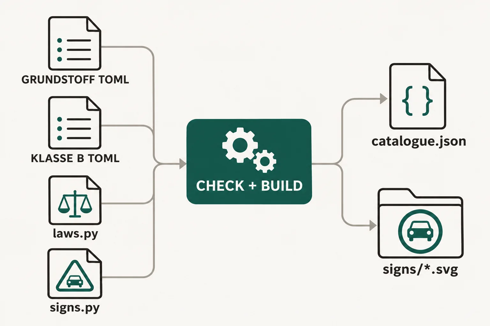

# Question data

The questions are original practice questions in TOML, written from German
traffic law. `make data` checks them and builds the catalogue the app bundles.



## Why original questions

The official question catalogue for the theory test is maintained by the
TÜV | DEKRA arge tp 21, and its wording, pictures and videos are licensed.
This public, MIT-licensed project therefore writes its own questions in the
style of the exam: the same topics, the same multiple-answer format and the
same 2-to-5 error points. Every explanation cites the paragraph it follows
from, and German laws are official works without copyright (§ 5 UrhG).

## Sections and topics

| Section | File | IDs | Exam share |
| --- | --- | --- | --- |
| Grundstoff | `questions/grundstoff.toml` | `G001`, `G002`, … | 20 of 30 questions |
| Zusatzstoff Klasse B | `questions/klasse-b.toml` | `B001`, `B002`, … | 10 of 30 questions |

Topics: `gefahren` (hazard awareness), `verhalten` (behaviour in traffic),
`vorfahrt` (right of way), `zeichen` (traffic signs), `umwelt`
(environment), `technik` (vehicle technology), `eignung` (fitness and
licences) and `betrieb` (operating vehicles). `TOPICS` in
`scripts/questions.py` names them in both languages.

## Writing a question

```toml
[[questions]]
id = "G001"          # section letter and three digits, never reused
topic = "vorfahrt"
points = 5           # error points a wrong answer costs, 2 to 5
sign = "z205"        # optional: a drawing in scripts/signs.py
law = "§ 8 StVO"     # optional: § N[a] or Anlage N of StVO, StVG, StVZO, FeV, StGB
keep_order = false   # optional: true keeps the options in this order
correct = [0, 2]     # every correct option, ascending

[questions.de]
q = "Was müssen Sie an diesem Verkehrszeichen tun?"
o = ["…", "…", "…"]  # 2 to 4 options
why = "…"            # why the answer is right

[questions.en]
q = "What must you do at this sign?"
o = ["…", "…", "…"]  # the same options, in the same order
why = "…"            # British English
```

| Point weight | Use it for |
| --- | --- |
| 5 | Right of way, the most dangerous hazards, alcohol |
| 4 | Other hazards, overtaking, fitness to drive |
| 3 | Signs, speeds, parking, the environment |
| 2 | Vehicle technology and paperwork |

Never change the meaning of a published question in place, since stored
answers and backups refer to it by ID: give a rewritten question a new ID.

## Checks

The build stops and lists every problem when an entry breaks a rule:

- Unknown or missing keys, wrong types, or text with stray whitespace.
- An ID outside its file's section, or an ID or German wording (with its sign)
  used twice.
- An unknown topic, points outside 2–5, or a sign without a drawing.
- A legal reference `laws.py` cannot turn into a link.
- Option lists of different lengths in German and English, fewer than two or
  more than four options, or a repeated option.
- `correct` that is empty, unsorted, repeats an index or points past the
  options.
- Numeric options (all starting with a digit) without `keep_order = true`.

`scripts/test_build_data.py` also checks that the committed catalogue and
sign drawings match a fresh build, that each section has enough questions
for several mock exams, and that every drawing is used.

## Legal references

`laws.py` links each reference to its page on
[gesetze-im-internet.de](https://www.gesetze-im-internet.de/), for example
`§ 8 StVO` to `stvo_2013/__8.html` and `Anlage 2 StVO` to
`stvo_2013/anlage_2.html`. Check a new reference against the current text
there before citing it: the StVO 2013 renumbered some rules (the roundabout
rule is § 8 Abs. 1a, not the old § 9a).

## Traffic signs

`signs.py` draws each sign as a small SVG from simple shapes, named after its
number in the Verkehrszeichenkatalog (`z205`, `z274-30`, `z330-1`). The
drawings are simplified, not to scale. Their alternative text gives only the
sign's number, so it does not give away the answer to "What does this sign
mean?". To add a sign, add a drawing and a `Sign` entry to `SIGNS`, then run
`make data`.
