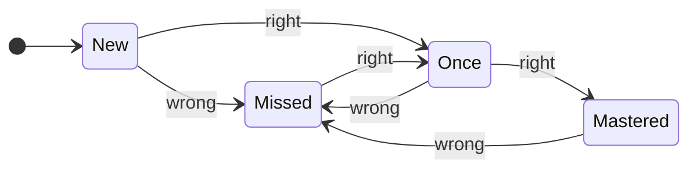

# Quiz design

How questions are chosen, presented and scored, and which questionnaire
practices the app follows. The rules live in `src/lib/quiz.ts` (selection),
`src/lib/mastery.ts` (mastery) and `src/lib/session.ts` (session state), all
covered by unit tests.

## Modes

| Mode | Questions | Feedback | Scoring |
| --- | --- | --- | --- |
| **Prüfungssimulation** (mock exam) | 20 random Grundstoff questions, then 10 random class B questions | None until you submit | Error points; passed with at most 10 and fewer than two missed 5-point questions; unanswered costs its points |
| **Üben** (practice) | 10, 20, 30 or 50 from the chosen focus; all of them for _Whole catalogue_ | After every answer | First-try accuracy |
| **Fragenkatalog** | Every question, searchable in German, English, by topic, sign name or question ID | Answers, explanation and legal basis on demand | Not scored |

The real class B test (first licence): 30 questions, 20 from the Grundstoff
and 10 from the class B Zusatzstoff, worth 110 points together, 45 minutes.
You pass with at most 10 error points, but two wrongly answered 5-point
questions fail the test even within that limit. These numbers live in one
constant, `EXAM`. A mock exam's questions are drawn at random, so its points
add up to roughly, not exactly, 110.

## Answers and error points

As in the real test, every question has two to four options and at least one
of them is correct. An answer counts only when exactly the correct options are
ticked: missing one, or ticking a wrong one, costs the question's 2 to 5 error
points. Results are judged in `isRight` (`src/lib/catalogue.ts`) and stored
by `progress.ts`, which re-judges every answer against the bundled key.

## Questionnaire practices

| Practice              | How it is applied                                                                                                                           |
| --------------------- | ------------------------------------------------------------------------------------------------------------------------------------------- |
| No order effects      | Questions are drawn and ordered at random every session (Fisher–Yates shuffle)                                                              |
| No position memory    | Answer options are shuffled per question and session; numeric options keep their order because it carries meaning |
| No accidental answers | Nothing is preselected; practice answers need an explicit _Prüfen · Check_                                                                  |
| Exam realism          | Answers stay editable until you submit; questions can be flagged; the submit dialog lists unanswered and flagged questions                  |
| Honest timing         | The exam timer is a wall-clock deadline, so reloading does not reset it; at zero the exam is submitted                                      |
| Robust sessions       | The active session is saved in the browser, so a reload or pause resumes where you left off                                                 |
| Accessible            | Native checkboxes, visible focus, keyboard shortcuts, screen-reader labels for ticked, missed and wrong options                               |

## Feedback on a wrong answer

- The error points the question costs.
- Every correct option in German **and** English, ticked or not.
- Your selection in both languages, with wrong ticks struck through.
- _Warum · Why_: an explanation of why the answer is right, with a link to
  the law it follows from.
- Your record on that question before this session (for example `2/3 correct`
  with ticks and crosses).
- In practice, the question is queued again after four other questions with
  freshly shuffled options. A second miss is not queued again, and second tries
  do not count towards the session score.

## Mastery

Each question's state comes from your most recent answers to it.

| State    | Rule                                  | Dashboard label                   |
| -------- | ------------------------------------- | --------------------------------- |
| New      | Never answered                        | Noch nicht gesehen · Not seen yet |
| Missed   | Last answer wrong                     | Zuletzt falsch · Missed last time |
| Once     | Last answer right, the one before not | Einmal richtig · Correct once     |
| Mastered | Last two answers right                | Sicher · Mastered                 |

## Practice focus

| Focus               | Picks                                                                                                                              |
| ------------------- | ---------------------------------------------------------------------------------------------------------------------------------- |
| Smart mix (default) | Up to half the session from _Missed_ and _Once_ questions, the rest from _New_ and _Mastered_, weighted by priority, then shuffled |
| Not seen yet        | Only _New_ questions                                                                                                               |
| My mistakes         | Only _Missed_ and _Once_ questions                                                                                                 |
| 5-point questions   | Only questions worth 5 error points: the ones that decide on their own                                                             |
| Whole catalogue     | Every question in random order                                                                                                     |
| Selected            | A given list, for example _Practise these again_ after a mock exam or the dashboard's weak spots                                   |

Priorities for the smart mix's weighted draw (Efraimidis–Spirakis sampling
without replacement):

| State    | Priority                                                                   |
| -------- | -------------------------------------------------------------------------- |
| Missed   | 6                                                                          |
| New      | 3                                                                          |
| Once     | 2, rising to 3 over three days since the last answer                       |
| Mastered | 0.25, rising to 1.75 over six days, so mastered questions resurface slowly |

## Dashboard figures

| Figure             | Definition                                                                                                              |
| ------------------ | ----------------------------------------------------------------------------------------------------------------------- |
| Latest mock exam   | Error points in the most recent mock exam, with pass or fail                                                            |
| Error points, last 3 | Mean error points over the last three mock exams                                                                      |
| Fewest error points | Best mock-exam result                                                                                                  |
| Mock exams passed  | Passed / taken                                                                                                          |
| Day streak         | Consecutive days with a finished session, ending today or yesterday                                                     |
| Score chart        | Mock exams as the share of points kept (a line) and practice first-try accuracy (dots), on one percent axis with the pass mark (10 of 110 points) and exam day |
| Catalogue coverage | Every question split by mastery state                                                                                   |
| Weak spots         | Up to eight questions you have missed: those missed last time first, then by number of misses, then most recent         |

## Keyboard

| Key                | Action                                        |
| ------------------ | --------------------------------------------- |
| `1`–`4` or `A`–`D` | Tick or untick an option                      |
| `Enter`            | Check, then next (practice); next (mock exam) |
| `←` `→`            | Previous / next question (mock exam)          |
| `F`                | Flag the question (mock exam)                 |
| `E`                | Show or hide the English column               |

Hiding English in the last days before the exam checks that you can read the
German alone. The results review still shows the correct and the chosen
options of every mistake in English, since that is where the translation helps
most. The real test can also be taken in English and other languages; this
app pairs German with English throughout.
